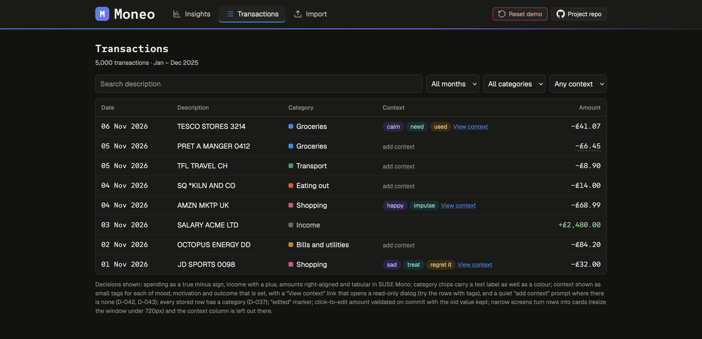
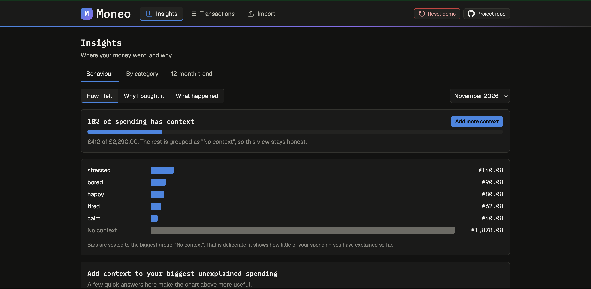
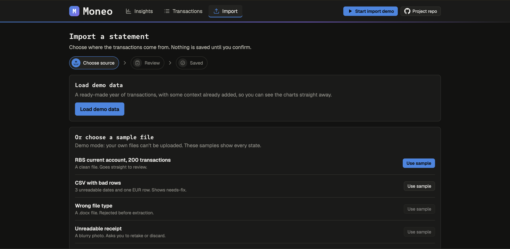

# Moneo

The why behind the buy. This is a personal finance web app (UK, GBP only) that shows where your money goes, and why. I am building this for personal use, but also as an opportunity to acquire new skills such as LangGraph, build and own decisions across the stack, and learn how to best work with AI.

While most budgeting apps tell you what you spent, Moneo also asks why: import a bank statement, categorise the spending, then add the mood, motivation and outcome behind a purchase and see the patterns in charts. The vision is using AI to empower me to make educated financial decisions.

**Mockups:** https://moneo-neon.vercel.app/ (work in progress; the screens below are design mockups, not the finished app yet)

| Import and review                                                         | Add context to a purchase                                                | Insights                                                       |
| ------------------------------------------------------------------------- | ------------------------------------------------------------------------ | -------------------------------------------------------------- |
|  |  |  |

## How I'm building this

Before I used any AI, I started with a clear set of specs: the problem, the users, the journeys, and Gherkin scenarios for how the app behaves (`docs/SPEC/SPEC.md`). Everything else is built on that foundation.

I use AI to write code, but I guide it all the way, making sure I review the code and understand decisions/unknowns. It has far been fantastic at helping me plan and learn. My approach is as follows:

- **Planning first.** The work is split into small slices, each one a thin piece of the app that works end to end. For every slice the AI writes a plan (`docs/slices/`), and nothing is built until I approve it.
- **Grilling.** Before I decide something big, I have the AI question me and challenge my choices, so I understand the trade-offs. This is how I moved the database from Neo4j to Postgres.
- **Everything written down.** Product decisions are logged in `docs/SPEC-DECISIONS/`, and technical decisions are architecture decision records in `docs/ADR/`.
- **Rules for the AI.** `AGENTS.md` says what the AI may and may not do. For example, it never merges: I review every pull request and merge it myself.

Project rules for contributors and AI agents are in `AGENTS.md`. The slice plan is in `docs/slices/README.md`.

## Run locally

Needs Node 22 and npm.

```bash
npm install
npm run dev
```

Open http://localhost:3000.

Saving a file updates the browser without a full reload (Fast Refresh). Restart `npm run dev` after changing `.env.local` or `next.config.ts`.

## Checks

```bash
npm run check      # typecheck, lint, format check and tests, in one go
npm test           # Vitest in watch mode: re-runs tests when you save a file
npm run format     # fix formatting with Prettier
npm run build
```

| Command                | What it does                                                                                |
| ---------------------- | ------------------------------------------------------------------------------------------- |
| `npm run typecheck`    | Generates Next.js route types, then runs `tsc --noEmit`                                     |
| `npm run lint`         | ESLint: Next.js, React and Hooks rules, plus type-aware TypeScript rules                    |
| `npm run format:check` | Prettier, without changing files (`docs/` is left out so the SPEC and ADRs stay as written) |
| `npm run test:run`     | Vitest once. Tests are `src/**/*.test.ts`, next to the code they test                       |

- Pull requests run all of these plus `npm run build` on GitHub (`.github/workflows/ci.yml`). `next build` does not lint, so CI is what catches lint errors.
- A Git hook (Husky and lint-staged) runs ESLint and Prettier on the files you commit. It is installed by `npm install`. `git commit --no-verify` skips it, CI does not.
- Only `src/lib/db.ts` may import `@neondatabase/serverless`. Lint enforces it.
- After re-adding a shadcn component (it overwrites the file), run `npm run format`.

## Deploy

The app is hosted on Vercel at https://moneo-neon.vercel.app/.

- Merging a pull request into `main` deploys to production.
- Every pull request gets its own preview deployment. Vercel posts the link on the pull request.
- If a build fails, the previous production version stays up.

## Environment variables

The names the app needs are in `.env.example`. Today these are `DATABASE_URL` (see Database below), plus two optional ones: `APP_MODE` (`demo` or `user`; missing or anything else means `demo`) and `USER_LIMIT_OVERRIDES` (JSON keyed by visitor ID, for example `{"visitor-id":{"maxRows":100}}`, read by `getLimits`).

- Locally: copy `.env.example` to `.env.local` and fill in the values. `.env.local` is ignored by git.
- On Vercel: add the same names under Project, Settings, Environment Variables.

Never commit real values. Only synthetic sample data goes on the deployed app.

## Database

Moneo stores its data in Postgres, hosted on Neon (https://console.neon.tech). The decision is in `docs/ADR/ADR-002.md`.

- **Neon** runs Postgres for us in the cloud. **`@neondatabase/serverless`** is the library in our server code that talks to it, sending each query over HTTP, so there is no connection pool to manage. `src/lib/db.ts` exports `getSql()`, which returns a client for one call. It is server-only: importing it from a Client Component fails the build.
- **Branches:** the Neon project has a `main` branch (the deployed app) and a `dev` branch (local work and Vercel previews). A branch is a copy of the database that can change without touching the other.
- **Set up:** in the Neon console, click Connect, pick a branch, and copy the connection string. Put the `dev` string in `DATABASE_URL` in `.env.local`. On Vercel, set `DATABASE_URL` to the `main` string for Production and the `dev` string for Preview. Never prefix it with `NEXT_PUBLIC_`.
- **Health check:** `GET /api/health` runs `SELECT 1`. It answers `200 {"status":"ok"}` or `503 {"status":"error"}`. The reason for a failure is in the server log, not in the response.
- **Idle database:** Neon suspends an idle database and wakes it on the next query, so the first request after a quiet period is slower. The connection timeout is 10 seconds to allow for that. Your data is not affected.
